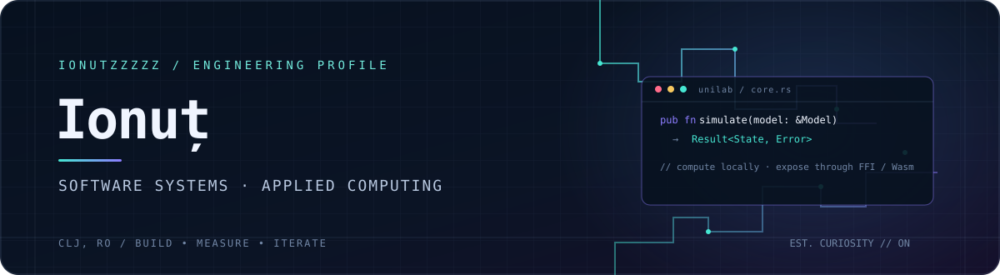
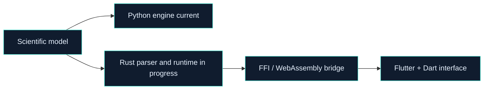

<div align="center">



### SOFTWARE ENGINEERING · SCIENTIFIC COMPUTING · SYSTEMS

I build across the stack: from **numerical methods and data pipelines** to **native interfaces and embedded experiments**. My current focus is turning complex technical ideas into tools that are fast, local-first, and usable.

[Explore projects](#02--selected-projects) · [Technical focus](#03--technical-focus) · [GitHub analytics](#05--github-analytics) · [All repositories](https://github.com/ionutzzzzz?tab=repositories)

<br />

<a href="https://github.com/ionutzzzzz"></a>
<a href="https://github.com/ionutzzzzz?tab=repositories"></a>
<a href="https://github.com/ionutzzzzz"></a>

</div>

---

## 01 / System profile

| Layer | What I work on | Evidence in my projects |
|:--|:--|:--|
| **Compute** | Numerical modeling, simulation, signal processing, scientific toolboxes | [UniLab](https://github.com/ionutzzzzz/UniLab) |
| **Data & intelligence** | Classification, exploratory analysis, knowledge-based systems | [Kaggle](https://github.com/ionutzzzzz/Kaggle) · [Smart-System](https://github.com/ionutzzzzz/Smart-System) |
| **Application engineering** | Cross-platform UX, web products, local-first workflows | [UniLab](https://github.com/ionutzzzzz/UniLab) · [OSUT App](https://github.com/osutcj/osut-app) |
| **Systems** | Rust, FFI, WebAssembly, local-first execution | [UniLab](https://github.com/ionutzzzzz/UniLab) |

## 02 / Selected projects

### [UniLab](https://github.com/ionutzzzzz/UniLab) — scientific computing, rebuilt for local-first execution

An environment for mathematical simulation, modeling, and analysis. The project is migrating from a Python-based engine toward a **Rust core** and a **Flutter/Dart interface**.

- **Compute:** Python transpiler and scientific toolboxes; Rust parser/runtime port in progress.
- **Interop:** `flutter_rust_bridge` with native and WebAssembly targets.
- **Product:** local workspace management, interactive plotting direction, desktop/mobile/web ambitions.
- **Scope:** 65+ scientific library toolboxes across control, signal processing, and applied mathematics.



### [Kaggle](https://github.com/ionutzzzzz/Kaggle) — applied machine learning

Competition work spanning classification, regression, feature analysis, and model evaluation. The repository includes reproducible notebooks and project artifacts built with **Python, pandas, NumPy, and scikit-learn**.

### [Smart-System](https://github.com/ionutzzzzz/Smart-System) — knowledge-based systems

Laboratory work exploring data-driven and knowledge-based methods with **Python, Jupyter, NumPy, pandas, and scikit-learn**.

### [OSUT App](https://github.com/osutcj/osut-app) — product engineering with a team

An application for OSUT Cluj volunteers and students, bringing organizational news, events, projects, resources, and communication into one place. The frontend uses **React 19, Vite, and Ant Design**; CI checks lint and production builds.

### [VS-CodeServer](https://github.com/ionutzzzzz/VS-CodeServer) — developer tooling

A small browser-based launcher for self-hosted VS Code servers, built with **HTML, CSS, and JavaScript**.

## 03 / Technical focus

<table>
  <tr>
    <td width="50%" valign="top">
      <strong>LANGUAGES & RUNTIMES</strong><br /><br />
      
      
      
      
      <br /><br />Python tooling · Rust systems code · numerical computing · transpilers
    </td>
    <td width="50%" valign="top">
      <strong>FRAMEWORKS & INTEROP</strong><br /><br />
      
      
      
      
      <br /><br />Flutter · React · FFI · WebAssembly · scientific notebooks
    </td>
  </tr>
  <tr>
    <td width="50%" valign="top">
      <strong>DATA & SCIENCE</strong><br /><br />
      
      
      
      <br /><br />Simulation · model evaluation · signal processing · knowledge systems
    </td>
    <td width="50%" valign="top">
      <strong>ENGINEERING WORKFLOW</strong><br /><br />
      
      
      
      <br /><br />Version control · CI · lint/build automation · reproducible experiments
    </td>
  </tr>
</table>

## 04 / Current direction

```text
problem framing  ->  model / algorithm  ->  implementation  ->  interface  ->  iterate
      math       ->   Python / Rust     ->    FFI / Wasm    -> Flutter / Web
```

I’m especially interested in the seam between **high-performance computation** and **approachable interfaces**: tools that keep complex workflows understandable, responsive, and close to the user’s machine.

## 05 / GitHub analytics

<div align="center">

<a href="https://github.com/ionutzzzzz">
  
</a>
<a href="https://github.com/ionutzzzzz">
  
</a>

<br />

<a href="https://github.com/ionutzzzzz/UniLab">
  
</a>
<a href="https://github.com/ionutzzzzz/Kaggle">
  
</a>

</div>

<sub>Language percentages reflect public repository code volume; they are a rough snapshot, not a measure of skill.</sub>

## 06 / Contribution calendar

<div align="center">
<picture>
  <source media="(prefers-color-scheme: dark)" srcset="https://ghchart.xqsit94.in/dark:46e6d2/ionutzzzzz" />
  
</picture>
</div>

---

<div align="center">

**Ionuț · Cluj-Napoca, Romania**<br />
[GitHub](https://github.com/ionutzzzzz) · [Repositories](https://github.com/ionutzzzzz?tab=repositories)

</div>
